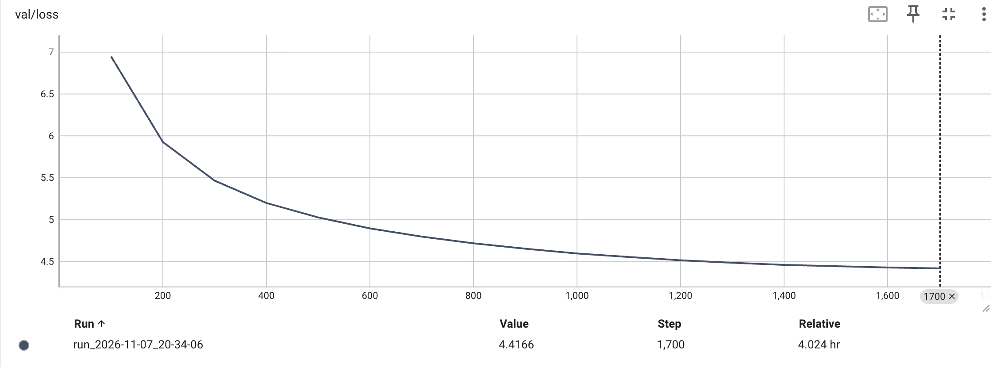

# Training

Reproduce the result from scratch: build the corpus, train the tokenizer, write the
token files, pre-train on the `base` config, then evaluate and sample. About 4 h 20 m
in total on a single 16 GB Apple M1, almost all of it pre-training. The result is
**val loss 4.4166 (perplexity 82.8, 0.6545 bits/byte)**.

New here? Install and run the tiny smoke test first: [Getting Started](getting-started.md).
All commands run from the **repo root** as modules (the leading `GPT.` matters). Every
script defaults to `GPT/configs/base.yaml`.

## 1. Build the corpus

GPT reuses BERT's Bengali Wikipedia file, so the encoder and the decoder train on the
same text. Build it once if it is not there:

```bash
python -m BERT.scripts.prepare_corpus            # → BERT/data/bn_wiki.txt (16,213 articles, ~120 MB)
python -m GPT.scripts.prepare_corpus             # → GPT/data/bn_wiki.txt, <|endoftext|> after each article
```

## 2. Train the tokenizer

Byte-level BPE, written from scratch (GPT-2 §2.2): 256 byte tokens + 7,935 merges +
`<|endoftext|>` = 8,192. About 5 minutes.

```bash
python -m GPT.scripts.train_tokenizer            # → GPT/tokenizer/base/merges.txt, vocab.json
```

## 3. Write the token files

Holds out 10% of the articles (seed 42: the same 1,621 articles BERT held out), encodes
both parts once, and writes them as 2-byte ids. About 25 seconds.

```bash
python -m GPT.scripts.prepare_data               # → GPT/data/train.bin, val.bin
```

Expect 11,039,689 train ids and 1,200,709 val ids, at about 9.8 bytes of text per token.

## 4. Pre-train

1,700 optimizer steps of 65,536 tokens: 111.4M tokens, about 10 passes over
`train.bin`. About 4 h 15 m on an M1. `caffeinate -s` keeps the Mac awake (on AC power;
on battery use `caffeinate -i`).

```bash
caffeinate -s python -m GPT.scripts.pretrain
```

Each invocation owns a fresh `GPT/checkpoints/base/run_<ts>/` with its own `best.pt`,
`last.pt` and frozen `config.yaml`. Every 100 steps it scores all of `val.bin` and
saves a checkpoint, so an interruption loses at most 100 steps. Resume from `last.pt`:

```bash
python -m GPT.scripts.pretrain --resume GPT/checkpoints/base/run_<ts>/last.pt
```

A resume continues exactly where the run stopped: the same batches, the same learning
rate, the same losses as a run that was never interrupted. To train **longer** than
planned, raise `training.max_steps` in the config and resume; the extra steps run at
the schedule's 10% floor learning rate.

Watch it train in another terminal:

```bash
tensorboard --logdir GPT/logs
```

## 5. Evaluate

Scores the leaderboard's best checkpoint on `val.bin`. About 50 seconds. It takes only
`--checkpoint` (default: the `best.pt` symlink) and reads the config snapshot beside it.

```bash
python -m GPT.scripts.evaluate
```

```
Val: 1,200,640 tokens scored (4,690 windows of 256) = 11,688,632 bytes (9.74 bytes/token)
Loss 4.4166 nats/token | perplexity 82.8 | 6.372 bits/token | 0.6545 bits/byte
```

Perplexity depends on the tokenizer; **bits per byte** does not, so it is the number to
compare against other models on the same text.

## 6. Generate

```bash
python -m GPT.scripts.generate --prompt "রবীন্দ্রনাথ ঠাকুর"
python -m GPT.scripts.generate --prompt ""        # a new article from nothing
```

Temperature, top-k, top-p, the number of samples and the seed are in
[`configs/generate.yaml`](../configs/generate.yaml). Expect fluent Wikipedia-style Bengali
with invented facts; at temperature 0 (greedy) the output repeats itself.

## What to expect

| Stage | Command | Time (M1, MPS) | Result |
|---|---|---|---|
| Corpus | `prepare_corpus` | < 1 s | 16,213 articles |
| Tokenizer | `train_tokenizer` | ~5 min | vocab 8,192, 9.81 bytes/token on train |
| Token files | `prepare_data` | ~25 s | 11.0M train / 1.2M val ids |
| Pre-train | `pretrain` | ~4 h 15 m | val loss 6.95 at step 100 → **4.4166** at 1,700 |
| Evaluate | `evaluate` | ~50 s | **0.6545 bits/byte**, perplexity 82.8 |
| Generate | `generate` | a few seconds | ~100 tokens/s |

Val loss at every eval (it improved at all 17, so `best.pt` is the last step):



Config fields, model spec and the checkpoint layout: [Architecture](architecture.md).
Speed on Apple Silicon: [Performance](performance.md).
